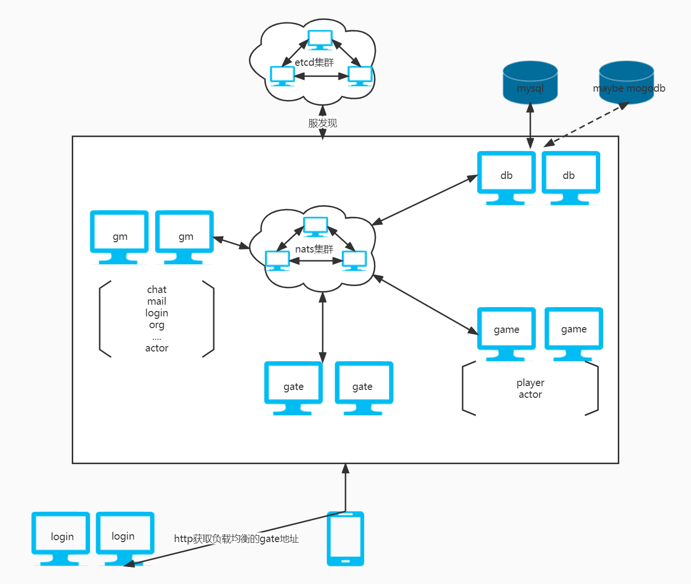

# go-actor [Golang 游戏服务框架]

**这是一款分布式的golang游戏服务器框架**

特性：

- [x] 高性能

- [x] 协程安全

- [x] 跨服务同步、异步无感通信

- [x] 毫秒级时间轮

- [x] 游戏状态机管理

- [x] 多节点snowflask uuid

- [x] websocket协议和protobuf编码

- [x] 高性能日志库mlog

``` 
新增 Rummy 人机算法 回溯+剪枝+深度优先搜索+贪心+补偿 性能还行

start := time.Now() // 记录开始时间
Train()
elapsed := time.Since(start) // 计算耗时
fmt.Printf("该操作耗时: %v\n", elapsed)

Race Init 手牌:2♣,2♥,10♦,10♦,4♦,J♦,9♦,5♣,9♣,A♦,K♦$,Q♠,A♥ 可吃明牌:9♥ 百搭牌：K♣$ 

New Round:1 手牌:2♣,2♥,10♦,10♦,4♦,J♦,9♦,5♣,9♣,A♦,K♦$,Q♠,A♥ 可吃明牌:9♥ 
手上牌型： 组合牌：A♥,2♥,A♥,K♦$ J♦,10♦,9♦  单牌:4♦,10♦,A♦,2♣,5♣,9♣,Q♠ 无效分:56 
吃牌牌型： 组合牌：2♣,2♥,K♦$ J♦,10♦,9♦  单牌:4♦,10♦,A♦,5♣,9♣,9♥,A♥,Q♠ 无效分:77 
优化出牌逻辑： 成对牌：A♦,A♥ 9♣,9♥  单牌：4♦,5♣,10♦,Q♠ 


New Round:2 手牌:4♦,9♦,10♦,10♦,J♦,K♦$,A♦,2♣,5♣,9♣,2♥,A♥,9♥ 可吃明牌:7♦ 
手上牌型： 组合牌：2♣,2♥,K♦$ J♦,10♦,9♦  单牌:4♦,7♦,10♦,A♦,5♣,9♣,9♥ 无效分:58 
吃牌牌型： 组合牌：2♣,2♥,K♦$ J♦,10♦,9♦  单牌:4♦,7♦,7♦,10♦,A♦,5♣,9♣,9♥ 无效分:65 
优化出牌逻辑： 成对牌：9♣,9♥ 7♦ 7♦  单牌：4♦,5♣,10♦,A♦ 
本轮： 抓牌收益不大于5分 不抓牌 
优化出牌逻辑： 成对牌：7♦ 7♦  单牌：4♦,5♣,9♣,10♦,Q♠,A♦ 
Round:2 手牌:4♦,7♦,7♦,9♦,10♦,10♦,J♦,K♦$,2♣,5♣,9♣,2♥,Q♠ 抽牌:Q♠ 


New Round:3 手牌:4♦,7♦,7♦,9♦,10♦,10♦,J♦,K♦$,2♣,5♣,9♣,2♥,Q♠ 可吃明牌:8♦ 
手上牌型： 组合牌：2♣,2♥,K♦$ J♦,10♦,9♦,8♦,7♦  单牌:4♦,7♦,10♦,5♣,9♣ 无效分:35 
吃牌牌型： 组合牌：7♦,8♦,10♦,K♦$ J♦,10♦,9♦,8♦,7♦  单牌:4♦,2♣,5♣,9♣,2♥ 无效分:22 
优化出牌逻辑： 成对牌：2♣,2♥  单牌：4♦,5♣,9♣ 
本轮： 抓牌收益不大于5分 不抓牌 
优化出牌逻辑： 成对牌： 单牌：2♣,4♦,5♣,9♣,A♦ 
Round:3 手牌:4♦,7♦,7♦,8♦,8♦,9♦,10♦,10♦,J♦,K♦$,2♣,5♣,9♣ 抽牌:A♦ 


New Round:4 手牌:4♦,7♦,7♦,8♦,8♦,9♦,10♦,10♦,J♦,K♦$,2♣,5♣,9♣ 可吃明牌:4♣ 
手上牌型： 组合牌：2♣,4♣,5♣,K♦$ J♦,10♦,9♦,8♦,7♦  单牌:4♦,7♦,8♦,10♦ 无效分:29 
吃牌牌型： 组合牌：7♦,8♦,10♦,K♦$ J♦,10♦,9♦,8♦,7♦  单牌:4♦,2♣,4♣,4♣,5♣ 无效分:19 
优化出牌逻辑： 成对牌：4♣,5♣ 2♣,4♣ 4♦,4♣  单牌： 
本轮： 抓牌收益不大于5分 不抓牌 
优化出牌逻辑： 成对牌：2♣,4♣ 4♦,4♣ 10♠  单牌： 
Round:4 手牌:4♦,7♦,7♦,8♦,8♦,9♦,10♦,10♦,J♦,K♦$,2♣,4♣,4♣ 抽牌:10♠ 


New Round:5 手牌:4♦,7♦,7♦,8♦,8♦,9♦,10♦,10♦,J♦,K♦$,2♣,4♣,4♣ 可吃明牌:5♥ 
手上牌型： 组合牌：7♦,8♦,10♦,K♦$ J♦,10♦,9♦,8♦,7♦  单牌:4♦,2♣,4♣,4♣ 无效分:14 
吃牌牌型： 组合牌：7♦,8♦,10♦,K♦$ J♦,10♦,9♦,8♦,7♦  单牌:4♦,2♣,4♣,4♣,5♥ 无效分:19 
优化出牌逻辑： 成对牌：2♣,4♣ 4♦,4♣  单牌：5♥ 
本轮： 抓牌收益不大于5分 不抓牌 
优化出牌逻辑： 成对牌：2♣,4♣ 4♦,4♣  单牌：3♠ 
Round:5 手牌:4♦,7♦,7♦,8♦,8♦,9♦,10♦,10♦,J♦,K♦$,2♣,4♣,4♣ 抽牌:3♠ 


New Round:6 手牌:4♦,7♦,7♦,8♦,8♦,9♦,10♦,10♦,J♦,K♦$,2♣,4♣,4♣ 可吃明牌:4♦ 
手上牌型： 组合牌：7♦,8♦,10♦,K♦$ J♦,10♦,9♦,8♦,7♦  单牌:4♦,4♦,2♣,4♣ 无效分:14 
吃牌牌型： 组合牌：7♦,8♦,10♦,K♦$ J♦,10♦,9♦,8♦,7♦  单牌:4♦,4♦,4♦,2♣,4♣ 无效分:18 
优化出牌逻辑： 成对牌：2♣,4♣ 4♦,4♣  单牌：4♦,4♦ 
本轮： 抓牌收益不大于5分 不抓牌 
优化出牌逻辑： 成对牌：J♠  单牌：2♣,4♦,4♦,4♦ 
Round:6 手牌:4♦,4♦,7♦,7♦,8♦,8♦,9♦,10♦,10♦,J♦,K♦$,2♣,J♠ 抽牌:J♠ 


New Round:7 手牌:4♦,4♦,7♦,7♦,8♦,8♦,9♦,10♦,10♦,J♦,K♦$,2♣,J♠ 可吃明牌:2♦ 
手上牌型： 组合牌：7♦,8♦,10♦,K♦$ J♦,10♦,9♦,8♦,7♦  单牌:2♦,4♦,4♦,2♣ 无效分:12 
吃牌牌型： 组合牌：7♦,8♦,10♦,K♦$ J♦,10♦,9♦,8♦,7♦  单牌:2♦,2♦,4♦,4♦,2♣ 无效分:14 
优化出牌逻辑： 成对牌：2♦,2♣ 2♦,4♦  单牌：4♦ 
本轮： 抓牌收益不大于5分 不抓牌 
优化出牌逻辑： 成对牌：2♦,4♦  单牌： 
Round:7 手牌:0$$,2♦,2♦,4♦,7♦,7♦,8♦,8♦,9♦,10♦,10♦,J♦,K♦$ 抽牌:0$$ 


New Round:8 手牌:0$$,2♦,2♦,4♦,7♦,7♦,8♦,8♦,9♦,10♦,10♦,J♦,K♦$ 可吃明牌:5♠ 
手上牌型： 组合牌：7♦,8♦,10♦,0$$ 2♦,4♦,K♦$ J♦,10♦,9♦,8♦,7♦  单牌:2♦ 无效分:2 
吃牌牌型： 组合牌：7♦,8♦,10♦,0$$ 2♦,4♦,K♦$ J♦,10♦,9♦,8♦,7♦  单牌:2♦,5♠ 无效分:7 
优化出牌逻辑： 成对牌： 单牌：2♦,5♠ 
本轮： 抓牌收益不大于5分 不抓牌 
优化出牌逻辑： 成对牌： 单牌：2♦ 
Round:8 手牌:0$$,2♦,4♦,7♦,7♦,8♦,8♦,9♦,9♦,10♦,10♦,J♦,K♦$ 抽牌:9♦ 


New Round:9 手牌:0$$,2♦,4♦,7♦,7♦,8♦,8♦,9♦,9♦,10♦,10♦,J♦,K♦$ 可吃明牌:$$$ 
吃牌胜利牌型： 组合牌：10♦,9♦,8♦ 2♦,4♦,0$$ 7♦,8♦,$$$ J♦,10♦,9♦  单牌:7♦ 
该操作耗时: 539.3µs

```

框架示意图：



## **快速开始**

### 安装启动

```
安装最新protoc
download for https://github.com/protocolbuffers/protobuf/releases
protoc --version
libprotoc 31.0

安装golang语言 1.24.3+:
https://go.dev/dl/

安装protoc-gen-go
go install google.golang.org/protobuf/cmd/protoc-gen-go@latest

安装protoc-go-inject-tag
go install github.com/favadi/protoc-go-inject-tag@latest

cd go-actor/tools/protoc-gen-xorm
go install

查看安装：
ls $(go env GOPATH)/bin
protoc-gen-go  protoc-gen-xorm  protoc-go-inject-tag

临时添加环境:
export PATH=$PATH:$(go env GOPATH)/bin

安装docker-composer: 

以上准备完毕后:
快速启动所有服务: 
make docker_run && make config && make start_all

快速终止所有服务:
make stop_all && make docker_stop
```


### 服务相关

状态机注册

```
// 注册方法
machine.RegisterState(pb.GameState_DEMO_STAGE_INIT, &demo.Initstate{})

// 启动方法
// onTick()
machine.NewMachine(nowMs, pb.GameState_DEMO_STAGE_INIT, game.(*unsafe.Pointer))

// 状态实例
type Initstate struct {
	BaseState
}


func (d *Initstate) OnEnter(nowMs int64, curState pb.GameState, extra interface{}) {
	game := extra.(*demo.DemoGame)

	// 重置房间状态
	game.Data.Stage = curState

	// init 初始化游戏
	if game.Data.Common.GameFinish {
		game.Reset() //重置房间
	}
}

func (d *Initstate) OnTick(nowMs int64, curState pb.GameState, extra interface{}) pb.GameState {
	return moveToState.(pb.GameState)
}

func (d *Initstate) OnExit(nowMs int64, curState pb.GameState, extra interface{}) {
    // log
}

```


新建一个非网关服务

```
func main() {
	var cfg string
	var nodeId int
	flag.StringVar(&cfg, "config", "config.yaml", "游戏配置文件")
	flag.IntVar(&nodeId, "id", 1, "服务ID")
	flag.Parse()

	// 加载游戏配置
	yamlcfg, node, err := yaml.LoadConfig(cfg, pb.NodeType_NodeTypeRoom, int32(nodeId))
	if err != nil {
		panic(fmt.Sprintf("游戏配置加载失败: %v", err))
	}
	nodeCfg := yamlcfg.Room[node.Id]

	// 初始化日志库
	mlog.Init(node.Name, node.Id, nodeCfg.LogLevel, nodeCfg.LogPath)

	// 初始化游戏配置
	mlog.Infof("初始化游戏配置")
	util.Must(config.Init(yamlcfg.Etcd, yamlcfg.Data))

	// 初始化框架
	mlog.Infof("启动框架服务")
	util.Must(framework.InitDefault(node, nodeCfg, yamlcfg))

	// 功能模块初始化
	mlog.Infof("初始化功能模块")
	message.Init()

	// 启动战斗服测试
	internal.Load()

	// 服务退出
	signal.SignalNotify(func() {
		recycle.Close()
		internal.Close()
		cluster.Close()
		mlog.Close()
	})
}
```

跨服务同步通讯 

```
err = cluster.RequestToNode(head, actorId, "ActorName.FuncName", joinReq, joinRsp)

// define to target node server
func RequestToNode(head *pb.Head, actorId uint64, actorFunc string, msg interface{}, rsp proto.Message) error {
	head.Dst = request.NewNodeRouter(pb.NodeType_NodeTypeXX, pb.RouterType_UID, head.Uid, actorId, actorFunc)
	return Request(head, msg, rsp)
}
```

跨服务异步通讯

```
head := &pb.Head{
	Src: framework.NewSrcRouter(pb.RouterType_ROOM_ID, d.GetRoomId()),
	Dst: framework.NewNodeRouter(pb.NodeType_NodeTypeXX, pb.RouterType_ROOM_ID, d.GetRoomId(), xxsvrId, "ActorName.FuncName"),
}
req := &pb.FuncNameReq{RoomId: d.GetRoomId()}
err := cluster.Send(head, req)
```

携带自动返回的异步通讯

```
// [autoRspActorId uint64,autoRspActorFunc string] 自动返回的路由id 和 方法路由
head := &pb.Head{
	Src: framework.NewSrcRouter(pb.RouterType_ROOM_ID, d.GetRoomId()[,autoRspActorId uint64,autoRspActorFunc string]),
	Dst: framework.NewNodeRouter(pb.NodeType_NodeTypeXX, pb.RouterType_ROOM_ID, d.GetRoomId(), xxsvrId, "ActorName.FuncName"),
}
req := &pb.FuncNameReq{RoomId: d.GetRoomId()}
err := cluster.Send(head, req)
```

同服务异步通讯

```
actor.SendMsg(head, req, rsp)
```

毫秒级定时器-时间轮，可有效降低golang自带四叉树最小堆计时器高度

```
m.RegisterTimer(&pb.Head{
    SendType:  pb.SendType_POINT,
    ActorName: "DbRummyRoomMgr",
    FuncName:  "OnTick",
}, 5*time.Second, -1)
```

创建一个actor，通过反射自动绑定路由

```创建一个actor
ret.Actor.Register(ret)
ret.Actor.ParseFunc(reflect.TypeOf(ret))
ret.SetId(uint64(pb.DataType_DataTypeReport))
ret.Start()
actor.Register(ret)
```

## **扩展工具**

### pbtool:

通过标签可自动生成pb对象，redis服务序列化、反序列化工具类

```
//@pbtool:[string|hash]|db_name|fieldName:fieldType|#备注
// 示例注释规则 @pbtool 表示protobuf对象参与注释解析 redis工具模板
// [string|hash] 表示protobuf对象序列化存储的两种模板
// db_name 指定存储db
// fieldName1:fieldType1[,fieldName2:fieldType2] 索引字段类型
// #备注 标签

@pbtool:string|poker|generator|#房间id生成器
@pbtool:hash|poker|user_info|uid@uint64|#玩家永久缓存信息
@pbtool:hash|poker|texas|RoomId@uint64|#德州游戏房间信息数据
```

### cfgtool:

解析文件table对象为指定pb文件

```
枚举类型说明：
E|道具类型-金币|PropertType|Coin|1    

配置规则说明：
@config|sheet@结构名|map:字段名[,字段名]:别名|group:字段名[,字段名]:别名
map: 工具类依据字段名筛选配置数据 多个字段名符复合筛选

example:
@config:table_cfg|网关接口路由表:RouterConfig|map:Cmd|map:NodeType,ActorName,FuncName

result make file content :
func MGetCmd(Cmd uint32) *pb.RouterConfig {
    obj, ok := obj.Load().(*RouterConfigData)
    if !ok {
        return nil
    }
    if val, ok := obj._Cmd[Cmd]; ok {
        return val
    }
    return nil
}

func MGetNodeTypeActorNameFuncName(NodeType pb.NodeType, ActorName string, FuncName string) *pb.RouterConfig {
    obj, ok := obj.Load().(*RouterConfigData)
    if !ok {
        return nil
    }
    if val, ok := obj._NodeTypeActorNameFuncName[pb.Index3[pb.NodeType, string, string]{NodeType, ActorName, FuncName}]; ok {
        return val
    }
    return nil
}

@struct|sheet@结构名
@enum|sheet
```

### 宿主机模式日志集成
```
初始化宿主机 fluent-bit

chmod -R 755 /workerdir/log
curl https://raw.githubusercontent.com/fluent/fluent-bit/master/install.sh | sh
todo vi /etc/fluent-bit/fluent-bit.conf vi /etc/fluent-bit/parser_multiline.conf
systemctl start fluent-bit
```

```
vi /etc/fluent-bit/fluent-bit.conf
[SERVICE]
    Flush         1
    Daemon        off
    Log_Level     debug
    Parsers_File  /etc/fluent-bit/parser_multiline.conf
[INPUT]
    Name               tail
    Path               /workerdir/log/*/*.log
    Tag                gamelog
    Read_from_Head     true
    Refresh_Interval   5
    multiline.parser   go_log_heapstack
    DB                 /var/log/game_json.db
[FILTER]
    name             parser
    match            gamelog
    key_name         log
    parser           go_log_header
[OUTPUT]
    Name              es
    Match             gamelog
    Host              es-host
    Port              9200
    Index             poker-logs
    Generate_ID       On
    Time_Key          datetime
    Replace_Dots      On
    Trace_Error       On
    Logstash_Format   Off
```

```
vi /etc/fluent-bit/parser_multiline.conf
[MULTILINE_PARSER]
    Name          go_log_heapstack
    Type          regex
    Flush_Timeout 1000
    rule          "start_state"  "/^\[\d{4}-\d{2}-\d{2} \d{2}:\d{2}:\d{2}\.\d{3}\]\s+\[[A-Z]+\]\s+/"  "cont"
    rule          "cont"         "/^(?!\[\d{4}-\d{2}-\d{2} \d{2}:\d{2}:\d{2}\.\d{3}\]\s+\[[A-Z]+\]\s+)/" "cont"
[PARSER]
    Name         go_log_header
    Format       regex
    Regex       ^\[(?<datetime>\d{4}-\d{2}-\d{2} \d{2}:\d{2}:\d{2}\.\d{3})\]\s+\[(?<level>[A-Z]+)\]\s+(?<message>[\s\S]+)$
    Time_Key     datetime
```